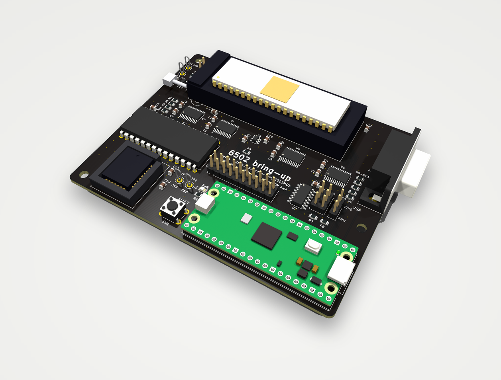
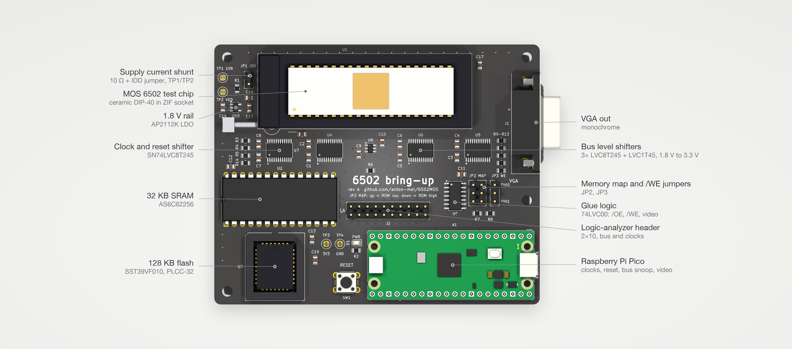

# Simplified 6502 MOS

A simplified version of the MOS 6502 8-bit microprocessor with only a subset of its instructions. The 6502 is a classic CPU that powered some of the popular early systems such as the Apple II and NES. 

## Bring-up board

`pcb/` is a KiCad 10 design for a two-layer, 100 × 80 mm board to bring up the chip once it is bonded into a DIP-40. The chip sits in a ZIF socket on its own 1.8 V rail. Four SN74LVC8T245 and one SN74LVC1T45 translate its bus to 3.3 V, where a 32 KB SRAM (AS6C62256) and a 3.3 V parallel flash (SST39VF010 in a PLCC-32 socket, programmed off-board) hold data and program. A Raspberry Pi Pico generates the two-phase clock and reset, snoops the bus and drives a monochrome VGA port. J2 (2×10) carries PHI0, PHI1, RESET, R/W̄, D0–D7, A11–A15 and /WE for a logic analyzer; the Pico sees the rest.

Only the first 32 KB of the flash is used.

| Jumper | Setting | Effect |
|---|---|---|
| JP2 MAP | LO (1-3, 2-4) | ROM $0000–$7FFF, RAM $8000–$FFFF, for PC = $0000 at reset |
| JP2 MAP | HI (3-5, 4-6) | ROM $8000–$FFFF, RAM $0000–$7FFF, for a reset vector at $FFFC |
| JP3 WE | PHI0 or PHI1 | phase that strobes /WE on writes |
| JP1 IDD | fitted / removed | |

Power comes from the Pico's USB. Its 3V3 output (300 mA max) feeds the 3.3 V side, which draws under 100 mA. An AP2112K-1.8 LDO makes 1.8 V for the translators and, through R1 and JP1, the chip (about 2.3 mA at 76.9 MHz from the simulated 4.1 mW). Pico pins: GP0–7 = A0–A7, GP8–15 = D0–D7, GP16–18 = A8–A10, GP19 = R/W̄, GP20–22 = PHI0, PHI1, RESET, GP26–28 = VIDEO, HSYNC, VSYNC (VIDEO is inverted by its buffer gate). Pull resistors hold RESET high and both clocks low while the Pico boots.
